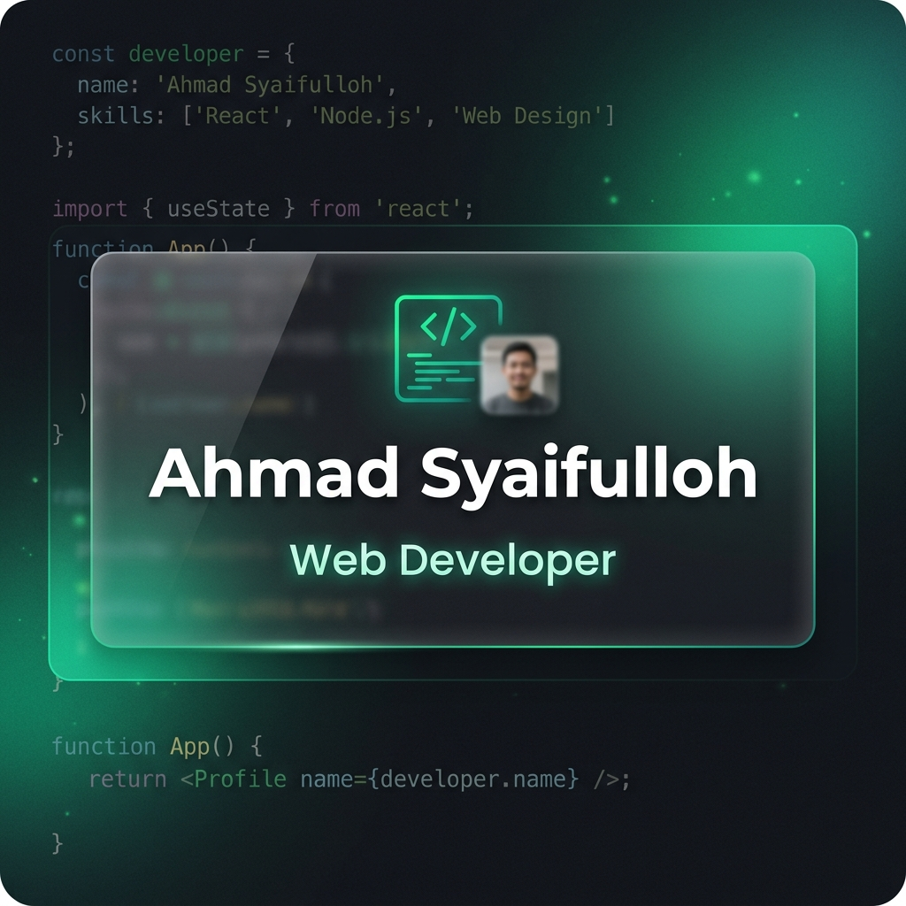

<div align="center">
  <a href="https://el-mas.web.id/" target="_blank">
    
  </a>
</div>

<br />

<div align="center">
  <a href="https://github.com/el-mas-dev">
    
  </a>
</div>

<div align="center">
  <a href="https://git.io/typing-svg">
    
  </a>
</div>

<div align="center">
  
  
  
</div>

<br />

<div align="center">
  <a href="https://el-mas.web.id/" target="_blank">
    
  </a>
  <a href="https://asyitech.id" target="_blank">
    
  </a>
  <a href="mailto:hello@asyitech.id">
    
  </a>
  <a href="https://www.linkedin.com/in/ahmad-syaifulloh-9536b03b7" target="_blank">
    
  </a>
  <a href="https://www.instagram.com/el.mas.sync" target="_blank">
    
  </a>
  <a href="https://github.com/el-mas-dev" target="_blank">
    
  </a>
</div>

<br />

## 👨‍💻 About Me

```yaml
name: Ahmad Syaifulloh
from: Surabaya, Indonesia 🇮🇩
role: Full-Stack & Mobile Developer
education: Informatics Engineering @ State University of Surabaya (UNESA)
focus:
  - 🔭 Crafting aesthetic, responsive & interactive web experiences
  - 📱 Building cross-platform mobile apps with Flutter & Android Studio
  - 💻 Building full-stack apps with Next.js, TypeScript, Laravel, Django & Supabase
  - 🤖 Exploring AI SDK integration, Linux VPS & IoT automation
fun:
  - 📢 Managing Faculty-level social media strategy & digital engagement
  - ⚡ Video editing, campus media coverage & experimenting with AI tools
```

<div align="center">
  <a href="https://www.unesa.ac.id/" target="_blank">
    
  </a>
  <b>Informatics Engineering Student</b> &bull; <a href="https://www.unesa.ac.id/" target="_blank"><b>Universitas Negeri Surabaya (UNESA)</b></a>
</div>

<br />

## 🚀 Featured Projects

<p align="center">
  🌐 <i>Explore Live Platforms:</i> 
  <a href="https://el-mas.web.id/" target="_blank"><b>Personal Portfolio</b></a> &bull; 
  <a href="https://asyitech.id" target="_blank"><b>Asyitech Hub</b></a>
</p>

<div align="center">
  <a href="https://github.com/el-mas-dev/System-Monitoring-Pesantren-">
    
  </a>
  <a href="https://github.com/el-mas-dev/LaskarSpace">
    
  </a>
</div>

<br />

## 🛠️ Languages & Tools

**💻 Programming Languages**

<p align="left">
  
</p>

**🎨 Frontend & Styling**

<p align="left">
  
</p>

**📱 Mobile Development**

<p align="left">
  
</p>

**⚙️ Backend & Database**

<p align="left">
  
</p>

**☁️ Cloud, DevOps & Dev Tools**

<p align="left">
  
</p>

**🤖 AI, Creative & Media Tools**

<p align="left">
  &nbsp;
  &nbsp;
  &nbsp;
  &nbsp;
  &nbsp;
  &nbsp;
  
</p>

<br />

## 🔥 GitHub Stats

<div align="center">
  
  
</div>

<div align="center">
  
</div>

<br />

## 🐍 Contribution Graph

<div align="center">
  <picture>
    <source media="(prefers-color-scheme: dark)" srcset="https://raw.githubusercontent.com/el-mas-dev/el-mas-dev/output/github-contribution-grid-snake-dark.svg" />
    <source media="(prefers-color-scheme: light)" srcset="https://raw.githubusercontent.com/el-mas-dev/el-mas-dev/output/github-contribution-grid-snake.svg" />
    
  </picture>
</div>

<br />

<div align="center">
  <h3>🤝 Let's Connect & Collaborate!</h3>
  <p>
    I'm always open to discussing web development projects, creative tech ideas, or professional opportunities.
  </p>
  <p>
    📫 Feel free to reach out via <a href="mailto:hello@asyitech.id"><b>hello@asyitech.id</b></a> or connect with me on <a href="https://www.linkedin.com/in/ahmad-syaifulloh-9536b03b7" target="_blank"><b>LinkedIn</b></a>.
  </p>
</div>
